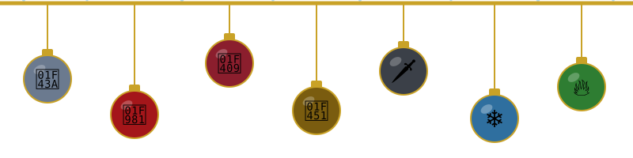

# ⚔️ Oi, eu sou o Luiz! 👋

**Desenvolvedor Front-end · Interfaces limpas · Acessibilidade por princípio**

*Menos dragões em produção, mais pixels no lugar certo.* 🐉

  
  
  
  

---

### 📜 O Pergaminho do Meistre

Eu construo interfaces limpas, acessíveis e responsivas, do tipo que recebe bem todo visitante, não importa de qual reino ele venha.

Minha filosofia de código, em três regras:

* 🛡️ **Acessibilidade em primeiro lugar.** Todo usuário merece um lugar à mesa, e não só quem tem o Trono de Ferro da internet rápida.
* 🧹 **Código limpo.** Organizado como a biblioteca da Cidadela, e não como Porto Real depois da Batalha da Água Negra.
* 🧪 **Testar antes de publicar.** Porque bug em produção é como casamento em Westeros: coisa boa não vem.

---

### 🌱 Treinando na Cidadela (aprendendo agora)

* **jQuery**: manipulação do DOM e AJAX. Mandar corvos (requisições) e esperar eles voltarem.
* **React**: interfaces baseadas em componentes. Construindo a Muralha um bloco reutilizável por vez.

---

### 🤖 A Armaria (linguagens e tecnologias)

  &nbsp;&nbsp;
  &nbsp;&nbsp;
  &nbsp;&nbsp;
  &nbsp;&nbsp;
  &nbsp;&nbsp;
  &nbsp;&nbsp;
  &nbsp;&nbsp;
  

| Arma | Papel no meu exército |
| --- | --- |
| 🏰 **HTML** | A fundação do castelo: sólida e semântica |
| 🎨 **CSS** | Os estandartes e brasões, onde mora o estilo |
| ⚡ **JavaScript** | O fogovivo: poderoso, mas manuseie com cuidado |
| 🔧 **jQuery** | O cavaleiro veterano: confiável e ainda na batalha |
| ⚛️ **React** | O novo dragão que estou aprendendo a montar |
| 🗡️ **Git** | O aço valiriano: cada commit é forjado para durar |
| ☕ **Java / C++** | Os deuses antigos, onde tudo começou |

---

### 🏠 A qual casa o meu código pertence?

| Casa | Característica | Combina comigo? |
| --- | --- | --- |
| 🐺 **Stark** | Honra, lealdade e commits limpos | ✅ Sempre |
| 🦁 **Lannister** | Paga suas dívidas técnicas | ✅ Uma hora paga |
| 🐉 **Targaryen** | Queima tudo e reescreve do zero | ⚠️ Só quando o refactor for mesmo necessário |
| 🦌 **Baratheon** | Publica rápido, testa depois | ❌ Nunca |

---

### 🎵 A Playlist do Bardo (tocando agora)

  

    
  

---

### 📊 Os Registros do Reino (estatísticas do GitHub)

  
  

  

---

### 🐺 O inverno está chegando... e o meu próximo deploy também.

*Valar Codeulis: todo dev deve codar.* ⚔️

